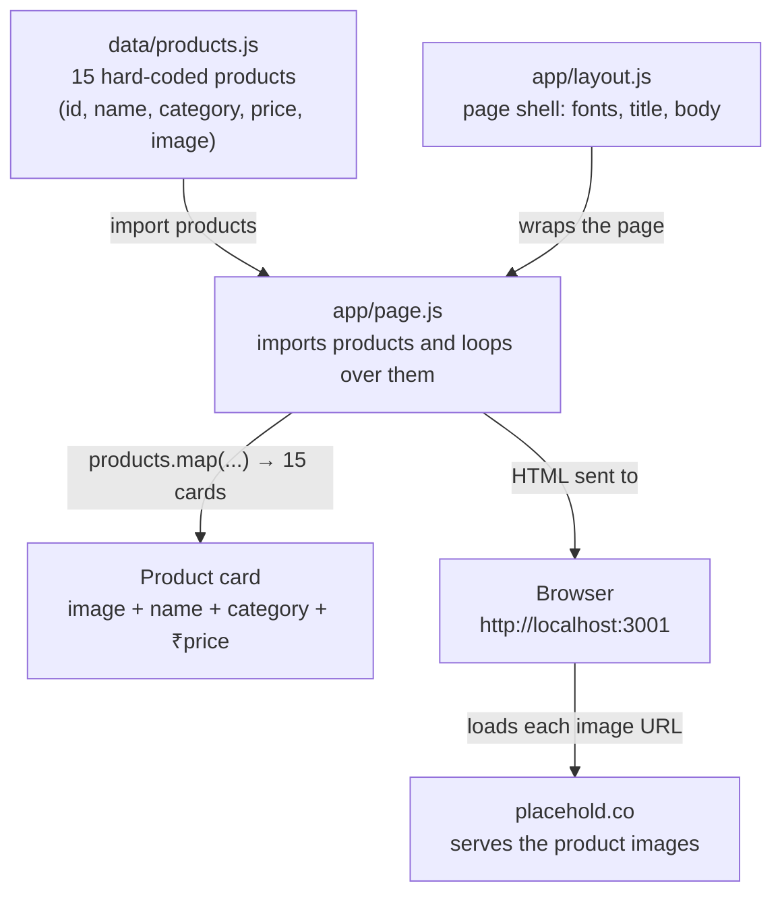
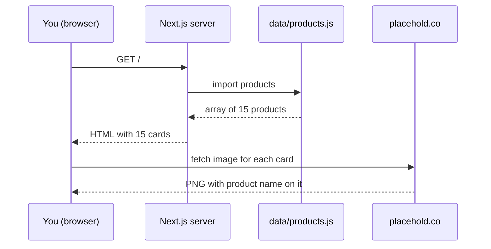

# How DemoKart Works

The product list is **not** fetched from a server or database. It lives in one plain JavaScript file, and the home page reads it directly.

## Flow chart



## Same thing as a request timeline



## What each file does

| File | Role |
|---|---|
| `data/products.js` | **The data source.** An array of 15 products. Edit this to add, remove or change products. |
| `app/page.js` | **The home page.** Imports the array, loops over it and draws one card per product. |
| `app/layout.js` | **The wrapper.** Sets the page title, fonts and background around every page. |
| `app/globals.css` | Loads Tailwind CSS for styling. |

## One product, end to end

```js
// data/products.js
{ id: 1, name: "Wireless Mouse", category: "Electronics", price: 699,
  image: "https://placehold.co/400x300/png?text=Wireless+Mouse" }
```

becomes, in `app/page.js`:

- `` is the picture, loaded from placehold.co
- `p.name` is the title
- `p.category` is the small label
- `₹{p.price}` is the price, formatted like `₹699`

## Want real data later?

Replace the `import products from "@/data/products"` line in `app/page.js` with a database or API call. The cards stay the same.
